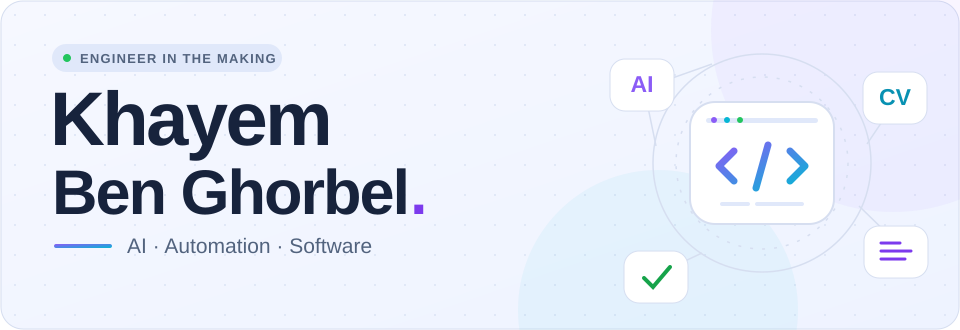
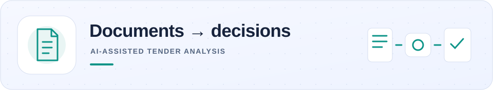
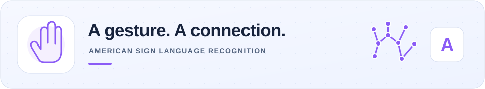
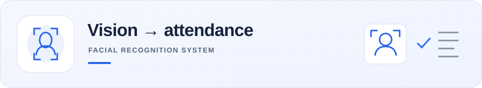
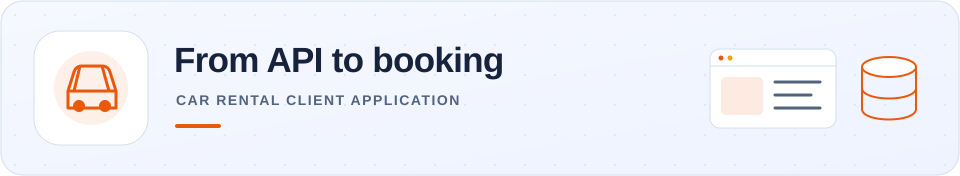
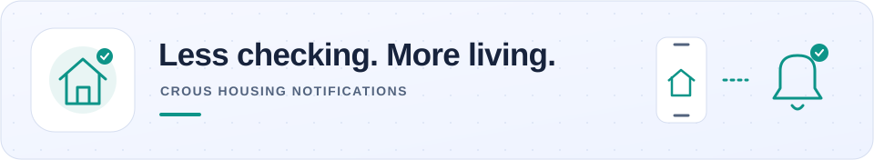
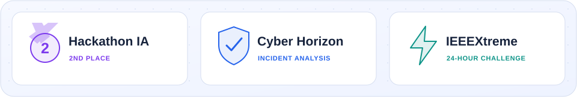

<picture>
  <source media="(prefers-color-scheme: dark)" srcset="assets/profile/hero-dark.svg">
  
</picture>

  <b>Computer Science Engineering student at CY Tech · Cergy, France</b> 
  From Tunisia 🇹🇳 · Building with AI, computer vision and code

  
  
  
  

> **Let's build something useful in 2027.** 
> 🔎 **Internship:** AI, data or software development · **4–6 months from March 2027**. 
> 🤝 **Alternance:** **contrat de professionnalisation · 12 months from September 2027**.

## 👋 A little about me

I'm **Khayem**, a Computer Science Engineering student at **CY Tech – Cergy Paris Université**, with a scientific background from the **Faculty of Sciences of Tunis**.

I enjoy turning a practical problem into working software: making documents easier to analyse, recognising a gesture with a camera, or automating a task that someone repeats every day. My interests span **applied AI, automation, full-stack development and cybersecurity**.

During my internships at **One Tech Business Solutions** and **Kernel Solutions & Innovation**, I worked on AI-assisted tender analysis and facial recognition attendance. I also like building under pressure with a team — including a **2nd-place finish at Hackathon IA**.

## 🧰 My toolkit

**Languages**

**AI & data**

**Web & development tools**

## 🏗️ Projects I'm proud of

### 📄 AI-assisted Tender Analysis · One Tech internship

<picture>
  <source media="(prefers-color-scheme: dark)" srcset="assets/profile/tender-dark.svg">
  
</picture>

**One Tech Business Solutions · R&D · June–August 2026**

A functional **Python proof of concept** to support the analysis of public calls for tenders, developed with the R&D team during my summer internship.

- Collected documents, extracted content with OCR, and integrated a **PostgreSQL** database.
- Orchestrated agents and tools with **MCP** and **n8n** workflows for structured, traceable **Go/No-Go decision support**.
- Added duplicate prevention, testing and technical documentation, then demonstrated the workflow.

**Stack:** Python · document extraction / OCR · PostgreSQL · MCP · n8n 
   

**Explore:** [GitHub — source code](https://github.com/khayem487/onetech-tender-agent) · [Illustrative demo](https://khayem487.github.io/portfolio/stage-demo/) · [Internship details](https://khayem487.github.io/portfolio/#experience)

The public walkthrough uses fictional data and a precomputed analysis to illustrate the workflow.

### 🤟 ASL Recognition · Hackathon IA, 2nd place

<picture>
  <source media="(prefers-color-scheme: dark)" srcset="assets/profile/asl-dark.svg">
  
</picture>

A webcam project for recognising **American Sign Language alphabet signs**, with an accessibility-oriented use case.

- Uses **OpenCV** and **MediaPipe** for the computer vision pipeline, with a **scikit-learn Random Forest** classifier.
- Includes a **Flask** demo and a reproducible training workflow in the current repository.
- Awarded **2nd place at Hackathon IA**, organised by IEEE Computer Society.

**Stack:** Python · OpenCV · MediaPipe · scikit-learn · Flask 
   

**Explore:** [Source code](https://github.com/khayem487/asl-recognition) · [Live demo](https://asl-recognition-demo.onrender.com)

### 🧬 Facial Recognition Attendance · Kernel internship

<picture>
  <source media="(prefers-color-scheme: dark)" srcset="assets/profile/attendance-dark.svg">
  
</picture>

A computer vision project developed during my internship at **Kernel Solutions & Innovation**, turning manual attendance recording into a software workflow.

- Detects and identifies faces in real time using **OpenCV** and the **face recognition** library.
- Records attendance in a **SQLite** database for office and classroom use cases.

**Stack:** Python · OpenCV · face recognition · SQLite 
  

**Explore:** [Source code](https://github.com/khayem487/Facial-Recognition-Attendance) · [Live demo](https://facial-attendance-demo.onrender.com)

### 🚘 Car Rental Client · Full-stack application

<picture>
  <source media="(prefers-color-scheme: dark)" srcset="assets/profile/rental-dark.svg">
  
</picture>

A rental management web application connecting a **Spring Boot REST API**, an **Oracle database**, and a web client.

- Covers vehicle booking and customer management.
- Connects the backend, database and client flow in one application.

**Stack:** Java · Spring Boot · Oracle Database · REST API 
  

**Explore:** [Source code](https://github.com/khayem487/car-rental-client) · [Live demo](https://car-rental-client-demo.onrender.com)

### 🏠 CROUS Notifier Me · Everyday automation

<picture>
  <source media="(prefers-color-scheme: dark)" srcset="assets/profile/notifier-dark.svg">
  
</picture>

A **Python automation tool** born from a real student need: keeping up with housing availability without repeating the same checks by hand.

- Monitors CROUS updates and sends notifications when changes are detected.
- Uses a lightweight workflow to automate repetitive checks.

**Stack:** Python · monitoring · notifications 
 

**Explore:** [Source code](https://github.com/khayem487/crous_notifier_me)

## 🏆 Hackathons & challenges

<picture>
  <source media="(prefers-color-scheme: dark)" srcset="assets/profile/hackathons-dark.svg">
  
</picture>

- 🥈 **Hackathon IA** — 2nd place with the ASL recognition project.
- 🛡️ **Cyber Horizon 1.0** — network crisis simulation and incident analysis.
- ⚡ **IEEEXtreme 18.0** — 24-hour international programming competition.

## 📊 Around GitHub

  <picture>
    <source media="(prefers-color-scheme: dark)" srcset="https://github-readme-stats.vercel.app/api?username=khayem487&show_icons=true&hide_rank=true&theme=tokyonight&hide_border=true">
    
  </picture>
  <picture>
    <source media="(prefers-color-scheme: dark)" srcset="https://github-readme-stats.vercel.app/api/top-langs/?username=khayem487&layout=compact&theme=tokyonight&hide_border=true">
    
  </picture>

---

  <b>Have a project, an internship or an alternance opportunity in mind?</b> 
  <a href="mailto:khayembg07@gmail.com">khayembg07@gmail.com</a> · <a href="https://www.linkedin.com/in/khayem-bg/">LinkedIn</a> · <a href="https://khayem487.github.io/portfolio/">Portfolio</a>  
  Always learning, always building. ✨

